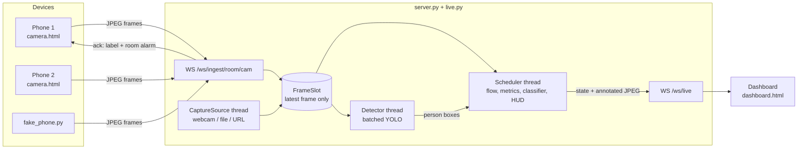
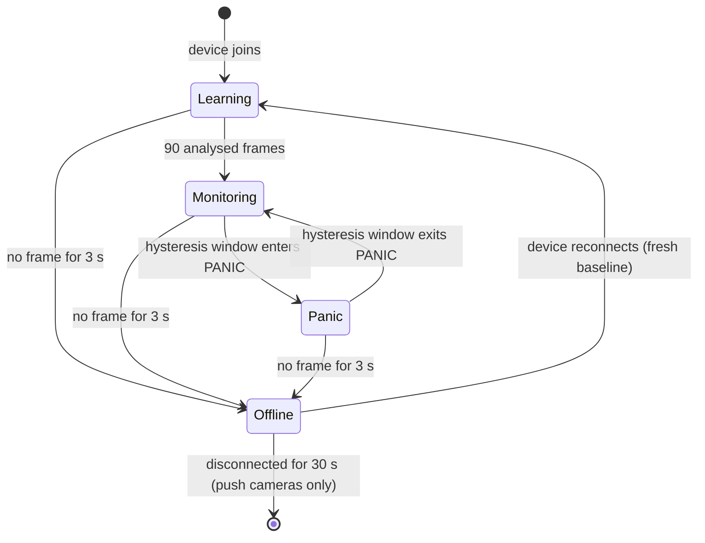

# Multi-camera rooms and phone cameras

This document explains how live monitoring works: rooms with several cameras, and phones that join a room by scanning a QR code.
The README has the quick start.
This page covers the design, the protocols, the security model, tuning, testing and troubleshooting.

## Contents

- [Concepts](#concepts)
- [Architecture](#architecture)
- [Why it is built this way](#why-it-is-built-this-way)
- [Camera lifecycle](#camera-lifecycle)
- [Exposing the server to phones](#exposing-the-server-to-phones)
- [Security model](#security-model)
- [Protocols](#protocols)
- [Performance and tuning](#performance-and-tuning)
- [Testing](#testing)
- [Troubleshooting](#troubleshooting)
- [Limitations and future work](#limitations-and-future-work)

## Concepts

A **room** is a named group of cameras, for example `lobby` or `gate`.
A **camera** is one video feed inside a room, identified as `room/camera`, for example `lobby/phone1`.

Cameras come in two kinds:

| Kind | Shown as | Where frames come from | How it is created |
| ---- | -------- | ---------------------- | ----------------- |
| push | `phone`  | A device sends frames to the server over a WebSocket | The first time a device joins as `room/camera` |
| pull | `stream` | The server opens a webcam, file or stream URL itself | Listed in `PANIC_SOURCES` at startup |

Rooms are created on demand.
There is nothing to configure before the first phone joins.
A room disappears when its last phone has been gone for 30 seconds.

**Every camera has its own classifier and its own calm baseline.**
This is the most important rule of the feature.
The default `scene-baseline` decision asks "is this much faster or more disordered than normal *for this camera*?".
Two phones in the same room see different scenes from different distances, so they cannot share an idea of normal.

**A room is in alarm when any of its online cameras is in PANIC.**
The alarm shows on the dashboard and on every phone in that room.

Names for rooms and cameras may use letters, digits, `-` and `_`, up to 32 characters.

## Architecture



### Components

| File | Role |
| ---- | ---- |
| `live.py` | `FrameSlot`, `CaptureSource`, `Camera`, `Registry`, `Scheduler`, `Detector` |
| `server.py` | Ingest endpoint, dashboard socket, join/QR endpoint, ngrok address detection, startup wiring |
| `auth.py` | `TokenGate`, the access-token middleware for HTTP and WebSockets |
| `camera.html` | The phone page: camera capture, streaming, alarm |
| `dashboard.html` | Room and camera tiles, the "Add a phone camera" panel with the QR code |
| `fake_phone.py` | Streams a video file exactly as a phone would |
| `detect.py` | `extract_boxes` and `draw_hud`, shared with the CLI and clip analysis |

### What happens to one frame

1. The phone draws its camera image onto a canvas at most 640 px on the long side and encodes it as JPEG at quality 0.6.
2. It sends the JPEG over `/ws/ingest/{room}/{cam}` and waits for the server's reply.
3. The server decodes it and puts it into that camera's `FrameSlot`, replacing any frame that has not been processed yet.
4. The server immediately replies with the camera's current label and the room's alarm state.
5. The **Detector** thread picks up the newest frame of every camera that is due for detection, runs one batched YOLO call over all of them, and stores each camera's person boxes.
6. The **Scheduler** thread picks up the newest frame of every camera that is due for analysis.
   For each one it computes optical flow against that camera's previous frame, calls `compute_metrics`, updates that camera's `PanicClassifier`, draws boxes, and encodes the annotated JPEG.
7. The dashboard socket sends the new state and the new annotated JPEG to every open dashboard.

## Why it is built this way

### Phones push JPEG over a WebSocket

Three options were considered:

| Option | Verdict |
| ------ | ------- |
| WebRTC | Lowest latency, but needs signalling, STUN/TURN and codec handling. Too much machinery for about 10 analysed frames per second. |
| An IP-camera app (e.g. "IP Webcam") that the server pulls from | Works with no code via `PANIC_SOURCES`, but Android only, same Wi-Fi only, and there is no way to show the alarm on the phone. |
| Browser page that pushes JPEG frames over a WebSocket | About 60 lines of browser code, works on iOS and Android, works through any tunnel, no new server dependencies. **Chosen.** |

The IP-camera app route still works and is a reasonable fallback, for example `PANIC_SOURCES="lobby/phone=http://192.168.1.20:8080/video"`.

### Latest frame only, never a queue

Every source writes into a single-slot `FrameSlot`.
A new frame overwrites one that has not been processed yet.
If the server falls behind, it skips stale frames instead of building up seconds of delay.
For an alarm system, an up-to-date picture matters more than seeing every frame.

The phone side does the same thing from the other direction.
It sends one frame, waits for the acknowledgement, then sends the next.
On a slow uplink it simply sends less often, and nothing piles up in the network.

### Analysis and detection run on separate threads

Measured on a 2-core laptop under load:

| Step | Cost per frame |
| ---- | -------------- |
| YOLOv8n person detection | 250-400 ms |
| Farneback optical flow at half scale | about 30 ms |
| Batched YOLO, 3 frames in one call | about 700 ms (instead of about 1100 ms for three single calls) |

The first version ran YOLO inside the analysis step, and cameras dropped to 0.3-0.6 analysed frames per second.

There is also a correctness reason.
`avg_speed` is motion **per processed frame**.
If the time between processed frames swings between 50 ms and 700 ms depending on the YOLO batch, the baseline learns that jitter as part of normal.
So the Scheduler only does the cheap work and holds each camera at a steady `PANIC_LIVE_FPS`, while the Detector runs YOLO separately at `PANIC_DETECT_FPS`.

The default decision rule uses only flow features (`avg_speed`, `direction_variance`, `flow_entropy`).
Person boxes that are a few hundred milliseconds old change nothing in the decision.
They only affect the drawn boxes and the `crowd_density` and `person_count` metrics.
Boxes from a frame of a different shape (for example before the phone rotated) are discarded.

With this split, three cameras held about 10 analysed frames per second each on the same laptop.

### One dashboard socket instead of one video stream per camera

Browsers allow only about 6 simultaneous HTTP/1.1 connections to one host.
An MJPEG `` per camera holds one connection open forever, so a 7th camera would never load and would also block every other request from the page.
The dashboard therefore receives the state of every room and every camera's annotated frame over one WebSocket, `/ws/live`.
The per-camera MJPEG endpoint `/video/{room}/{cam}` still exists for viewing a single feed directly or in VLC.

## Camera lifecycle



| Event | What happens |
| ----- | ------------ |
| Device joins | The camera is created and starts learning. At 10 fps the 90-frame warm-up takes about 9 seconds. |
| No frame for 3 seconds | The tile shows OFFLINE. An offline camera never counts toward the room alarm. |
| Device disconnected for 30 seconds | A push camera is removed. A room with no cameras left is removed. |
| Device reconnects under the same name | It takes the camera back with a **fresh baseline**, because a phone that dropped off has probably been moved. |
| Phone switches lens (Flip) | The page sends a `reset` message and the baseline is relearned, because the other lens sees a different scene. |
| Frame size changes (phone rotated) | The server notices the new shape and relearns the baseline. |
| A looped file restarts, or a webcam drops out | The jump is marked as a cut, and optical flow is never computed across it, so the jump does not read as a burst of motion. |
| Second device tries an active name | It is refused with close code 4409. The phone page asks for a different camera name. |

**Taking over a silent camera.**
When a phone loses Wi-Fi, the server may not notice the dead connection for up to about 40 seconds (the WebSocket ping timeout).
If the phone reconnects in that time, it is allowed to take the camera back as soon as the camera has received no frames for 3 seconds.
Each connection carries a generation number, so when the old connection finally closes it cannot mark the new one as disconnected.

## Exposing the server to phones

Phone browsers only give a page camera access in a **secure context**: HTTPS, or `localhost` on the device itself.
`http://192.168.x.x:8000` does not qualify, so the camera button would fail.
A tunnel gives the server an HTTPS address that works from any network.

| Option | Command | Notes |
| ------ | ------- | ----- |
| ngrok | `ngrok http 8000` | The dashboard fills in the address automatically. The free plan shows a one-time "You are about to visit" page and has a monthly data allowance. |
| Cloudflare quick tunnel | `cloudflared tunnel --url http://localhost:8000` | No account, no data cap. Paste the printed `https://….trycloudflare.com` address into the dashboard. |
| Fixed address | set `PANIC_PUBLIC_URL=https://your.domain` | Use when you run your own reverse proxy with a certificate. |
| Same Wi-Fi, no tunnel | `uvicorn ... --host 0.0.0.0 --ssl-keyfile key.pem --ssl-certfile cert.pem` | Lowest latency and no data limits. Each phone must accept or trust the certificate (`mkcert` helps). |

How the dashboard finds the address, in order:

1. `PANIC_PUBLIC_URL`, if set.
2. A running ngrok agent, asked through its local API at `http://127.0.0.1:4040/api/tunnels` (cached for 5 seconds).
3. The dashboard's own address, if the dashboard itself is being viewed through the tunnel.
4. Otherwise the field stays empty and the panel explains how to start a tunnel.

### Bandwidth

The phone page sends about 10 frames per second.
The synthetic test clip measured about 22 KB per frame, and real camera scenes are typically 20-40 KB.
That is about 200-400 KB/s per phone, or roughly 0.7-1.4 GB per hour.
Viewing the dashboard through the tunnel as well adds the annotated frames on top.
For long sessions, prefer Cloudflare or a same-network setup over the ngrok free plan.

## Security model

Exposing the server through a tunnel puts it on the public internet.
Without protection, anyone holding the address could watch every camera or push fake frames into a room.

The `TokenGate` middleware in `auth.py` applies to every HTTP request and every WebSocket:

| Request | Allowed? |
| ------- | -------- |
| Directly from this computer (`127.0.0.1` or `::1`) with no proxy headers | Yes, no token needed. |
| Carries `?token=<token>` | Yes, and the response sets the `panic_token` cookie. |
| Carries a valid `panic_token` cookie | Yes. |
| Anything else (through a tunnel, or from another device) | HTTP 401 page, or WebSocket closed with code 4401. |

Details:

- The token comes from `PANIC_TOKEN`.
  If that is not set, a random token is generated at startup and printed in the console.
- Tunnel agents connect to the server from `127.0.0.1`, so "is the client local?" alone is not enough.
  Tunnels always add forwarding headers (`X-Forwarded-For`, and `Cf-Connecting-Ip` for Cloudflare), and any of those headers means the token is required.
- The cookie is `HttpOnly`, `SameSite=Lax`, valid for 30 days, and marked `Secure` when the request arrived over HTTPS.
- Tokens are compared in constant time.
- The QR link contains the token.
  Treat it like a password and only share it with devices you trust.
- Change `PANIC_TOKEN` and restart to cut off every device that had the old one.

Keep uvicorn bound to `127.0.0.1` when using a tunnel.
The tunnel connects locally, so nothing else needs to be opened on your network.

## Protocols

### Phone ingest: `WS /ws/ingest/{room}/{cam}?token=…`

The device sends **binary** messages, each one a complete JPEG image (at most 2 MB).
After each frame, the server replies with a **text** message containing JSON:

```json
{
  "label": "NORMAL",
  "score": 1.4,
  "warming_up": false,
  "fps": 9.8,
  "room_alarm": true,
  "panic_cams": ["phone2"],
  "decoded": true
}
```

| Field | Meaning |
| ----- | ------- |
| `label` | This camera's current decision, `NORMAL` or `PANIC` |
| `score` | Robust z-score of the latest frame against this camera's baseline (alarm threshold `k = 4.0`) |
| `warming_up` | `true` while the baseline is still being learned; no alarms are possible yet |
| `fps` | How many of this camera's frames the server analyses per second |
| `room_alarm` | `true` if any online camera in the room is in PANIC |
| `panic_cams` | Which cameras in the room are in PANIC |
| `decoded` | `false` if the frame was not a valid image (it is ignored) |

The device should wait for the reply before sending the next frame.
That is what keeps the delay low on slow connections.

The device may also send a **text** control message:

| Message | Effect |
| ------- | ------ |
| `{"type": "reset"}` | Forget this camera's baseline and learn again (used after switching lens) |

Close codes the server uses:

| Code | Meaning | What the phone page does |
| ---- | ------- | ------------------------ |
| 4400 | Invalid room or camera name | Shows the naming rule and stops |
| 4401 | Missing or wrong access token | Asks you to reopen the QR link and stops |
| 4409 | Name already active, or replaced by a newer connection | Asks for a different camera name and stops |
| 4413 | Frame larger than 2 MB | Reconnects |
| anything else | Network problem or server restart | Reconnects after 1.5 seconds |

The phone page also closes and reconnects if no reply arrives within 8 seconds.

### Dashboard feed: `WS /ws/live`

About five times per second the server sends a text message with the full state:

```json
{
  "type": "state",
  "rooms": [
    {
      "room": "lobby",
      "alarm": false,
      "panic_cams": [],
      "cameras": [
        {
          "id": "lobby/phone1", "room": "lobby", "cam": "phone1", "kind": "push",
          "online": true, "label": "NORMAL", "warming_up": false,
          "score": 0.9, "panic_ratio": 0.0, "fps": 10.1,
          "backend": "scene-baseline", "degraded": false,
          "metrics": {"avg_speed": 0.59, "direction_variance": 0.49,
                      "flow_entropy": 2.45, "crowd_density": 0.085, "person_count": 15}
        }
      ]
    }
  ]
}
```

Whenever a camera has a new annotated frame, the server sends a binary message:

```
byte 0         length N of the camera id
bytes 1..N     camera id, UTF-8 (for example "lobby/phone1")
bytes N+1..    JPEG image
```

### Other endpoints

| Method | Path | Purpose |
| ------ | ---- | ------- |
| `GET` | `/api/rooms` | Same room state as above, plus `public_url`, `live_fps` and `ffmpeg` |
| `GET` | `/api/join?room=&cam=&base=` | Returns `{url, svg, secure}`: the join link, its QR code as SVG, and whether the address is HTTPS |
| `GET` | `/camera?room=&cam=&token=` | The phone page, with room and camera prefilled |
| `GET` | `/video/{room}/{cam}` | MJPEG stream of one camera's annotated feed |

## Performance and tuning

| Env var | Default | Effect |
| ------- | ------- | ------ |
| `PANIC_LIVE_FPS` | `10` | Maximum analysed frames per second per camera. Lower it to fit more cameras on a slow machine. |
| `PANIC_DETECT_FPS` | `3` | Maximum person detections per second per camera. Lower it first if the CPU is saturated, since it does not affect the default decision. |
| `PANIC_TOKEN` | random | Access token, see [Security model](#security-model) |
| `PANIC_PUBLIC_URL` | auto | Address used for QR links, see [Exposing the server to phones](#exposing-the-server-to-phones) |
| `PANIC_BACKEND` | `scene-baseline` | Decision backend, shared with the rest of the project |

The phone page accepts `?fps=` (1 to 30, default 10) to change how often it sends.
Keep it equal to `PANIC_LIVE_FPS`.
Sending faster than the server analyses only wastes bandwidth.

**Keep each camera's rate steady.**
Changing `PANIC_LIVE_FPS` or a phone's `fps` changes how much motion happens between analysed frames.
The baseline adapts, because it is learned per camera, but only if the rate stays the same after warm-up.

**Capacity.**
Analysis costs roughly 30-40 ms of CPU per camera frame, including drawing and JPEG encoding.
At 10 fps, that is about a third of one CPU core per camera, plus detection.
When the machine runs out of CPU, every camera slows down evenly rather than one camera stalling.
The dashboard shows each camera's real analysed rate as **Analysed**.

Uploaded-clip analysis uses the same CPU.
Live cameras slow down while a clip is being analysed.

## Testing

### Automated tests

```bash
PY -m pip install -r requirements-dev.txt
PY -m pytest
```

| File | What it covers |
| ---- | -------------- |
| `test_live.py` | Source parsing, latest-frame slot, per-camera classifiers, name conflicts, takeover, pruning, room alarm, analysis fps cap, batched detection, cuts and rotation. Uses a stub detector, so it runs in seconds. |
| `test_server.py` | The real app in-process with real YOLO: token rules (including tunnel headers), phone ingest end to end, the dashboard socket, duplicate names, the reset message, bad frames, join links, ngrok address detection. |

### Simulated phones

`fake_phone.py` uses the same WebSocket protocol as the phone page:

```bash
# one calm camera and one that goes into panic, in the same room
PY fake_phone.py --source demo_crowd_30s.avi --room lobby --cam calm1 --loop
PY fake_phone.py --source panic_test.avi --room lobby --cam sim1 --every-frame
```

Create `panic_test.avi` first with `PY make_test_video.py`.
It has only 6 seconds of calm, which at 10 fps is 60 frames, fewer than the 90-frame warm-up.
`--every-frame` sends all 240 frames at the chosen rate instead of skipping frames to match real time.
That keeps the clip's per-frame motion exactly and gives the baseline 120 calm frames to learn from.

Expected output:

```
[fake_phone] t=   0.1s frame     1  LEARNING
[fake_phone] t=   9.1s frame    92  NORMAL
[fake_phone] t=  12.7s frame   128  PANIC  room alarm: ['sim1']
```

### Testing the real phone page without a phone

Chrome can use a video file as its camera.
This exercises the real page: camera capture, canvas, JPEG, WebSocket and the alarm.

```bash
ffmpeg -i panic_test.avi -vf "setpts=2*PTS" -r 10 -pix_fmt yuv420p cam.y4m
chrome --use-fake-ui-for-media-stream --use-fake-device-for-media-stream \
       --use-file-for-fake-video-capture=cam.y4m \
       "http://localhost:8000/camera?room=gate&cam=browser1"
```

Tap **Start**.
The badge goes from LEARNING to NORMAL, then to PANIC, and the alarm banner appears.

## Troubleshooting

| Symptom | Cause and fix |
| ------- | ------------- |
| Phone page says it needs HTTPS | The page was opened over plain `http://` from another device. Use the `https://` link or QR code from a tunnel. |
| "Camera permission was denied" | Allow camera access for the site in the browser's site settings, then tap Start again. On iOS: Settings, Safari, Camera. |
| "The access token is missing or wrong" | The QR link is from before a server restart and `PANIC_TOKEN` was not set. Generate a new QR code, or set `PANIC_TOKEN` so it stays the same. |
| "Another device is already streaming as …" | Two phones chose the same camera name in a room. Pick a different name. |
| Phone page loops on "reconnecting…" | The server is down or the tunnel stopped. Check both terminals. A free ngrok address changes every time ngrok restarts, so make a new QR code. |
| ngrok shows "You are about to visit" | Normal on the free plan. Tap **Visit Site** once. |
| A camera stays on LEARNING | It has not yet analysed 90 frames. Check its **Analysed** rate. At 1 fps, warm-up takes 90 seconds. |
| False alarms from a phone | The phone is moving. Prop it or mount it. Camera shake looks like crowd movement. |
| No alarm ever, even with obvious panic | The feed was not calm during warm-up, so it learned the agitated state as normal. Flip twice or reconnect while the scene is calm. |
| Low **Analysed** fps on every camera | The CPU is saturated. Lower `PANIC_DETECT_FPS` first, then `PANIC_LIVE_FPS`, or use fewer cameras. Pause clip uploads while monitoring. |
| Dashboard field "Address the phone will open" stays empty | No ngrok agent is running, or you use another tunnel. Paste its HTTPS address, or set `PANIC_PUBLIC_URL`. |
| Phone screen turns off and the stream stops | The page asks the browser to keep the screen on, but some browsers refuse. Turn off auto-lock while monitoring. When you return to the page it restarts the camera and reconnects. |
| `fake_phone.py` gets HTTP 403 | Something else is running on that port, or the URL is wrong. Check with `netstat -ano` and pass `--url`. |

## Limitations and future work

- **Alerts reach only open pages.**
  The dashboard and the phones in the room flash, beep and vibrate, but nothing is sent by push notification, SMS or email.
- **No camera-shake compensation.**
  Subtracting the global (median) flow before computing metrics would let a handheld phone work.
  This would change `compute_metrics`, which every part of the project shares, so it needs its own evaluation.
- **Each feed assumes it starts calm.**
  This is inherited from `scene-baseline`.
- **One server process.**
  Rooms live in memory, so a restart forgets them and phones reconnect with a fresh baseline.
- **Mobile browsers stop the camera in the background.**
  The page must stay open and visible on the phone.
